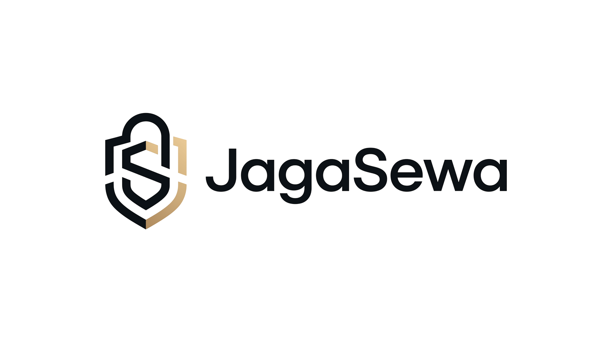

# 👘 JagaSewa

<p align="center">
  
</p>

<p align="center">
  <strong>Platform Booking & Manajemen Rental Barang (Kostum, Kamera, Kebaya) Mobile-First</strong>
</p>

<p align="center">
  <a href="#persyaratan-sistem">Persyaratan</a> •
  <a href="#panduan-instalasi">Instalasi</a> •
  <a href="#cara-menjalankan">Cara Menjalankan</a> •
  <a href="#akun-demo--rute-aplikasi">Akun Demo</a> •
  <a href="#pengujian">Testing</a> •
  <a href="#arsitektur--keamanan">Arsitektur</a>
</p>

---

## 📌 Tentang JagaSewa

**JagaSewa** adalah platform web booking rental barang (*mobile-first*) yang dirancang khusus untuk toko/vendor yang berjualan melalui media sosial (Instagram, X/Twitter, TikTok). 

Penyewa dapat mengecek ketersediaan tanggal dan melakukan reservasi **tanpa perlu registrasi/login**. Vendor mengelola jadwal booking, persetujuan sewa, status barang, dan denda melalui dashboard terpusat.

### ✨ Fitur Unggulan

- **Direct Booking Tanpa Login:** Penyewa cukup mengakses tautan toko/barang dari bio media sosial untuk reservasi.
- **Smart Buffer Calendar:** Kalender interaktif cerdas yang otomatis memperhitungkan jeda pengiriman barang (*buffer before*) dan waktu cuci/inspeksi/laundry (*buffer after*), mencegah tabrakan jadwal sewa.
- **Pencegahan Double-Booking:** Transaksi atomik dengan *Pessimistic Locking* (`SELECT ... FOR UPDATE`) pada level database MySQL untuk mencegah *race condition* saat berebut slot tanggal.
- **Keamanan Data Pribadi (UU PDP):** 
  - Foto KTP & selfie di-re-encode otomatis, metadata EXIF dihapus, dan diberi watermark dinamis (*"VERIFIKASI JAGASEWA - [VENDOR] - [TANGGAL]"*).
  - Penyimpanan berkas privat dengan akses terbatas melalui *Signed URL* (TTL ≤ 60 menit).
  - Retensi & pembersihan otomatis: berkas KTP dihapus permanen oleh background scheduler setelah masa sewa selesai.
- **Blind Index Blacklist:** Pencarian penyewa bermasalah menggunakan hashing HMAC-SHA256 (`BLACKLIST_SECRET`) tanpa menyimpan plaintext NIK/No. WA di tabel pencarian.
- **Multi-Vendor Panel (Filament v5):** Dashboard terisolasi ketat untuk masing-masing vendor guna memantau katalog barang, pesanan masuk, persetujuan sewa, dan pengembalian barang.
- **Integrasi WhatsApp:** Tautan langsung ke `wa.me` untuk konfirmasi pemesanan dan koordinasi pengiriman.

---

## 🛠️ Stack Teknologi

- **Backend Framework:** Laravel 13 (PHP 8.2+)
- **Admin & Vendor Dashboard:** Filament v5 & Livewire v4
- **Database:** MySQL 8 / MariaDB (atau SQLite untuk uji coba lokal cepat)
- **Frontend / Styling:** Tailwind CSS 4 + Vite
- **Storage:** S3-compatible Backblaze B2 (Bucket Privat) / Local Disk
- **Queue & Cache:** Database Driver (`QUEUE_CONNECTION=database`, `CACHE_STORE=database`)
- **Zona Waktu:** `Asia/Jakarta` (WIB)

---

## 💻 Persyaratan Sistem

Pastikan perangkat lokal Anda telah terpasang:

1. **PHP >= 8.2** (direkomendasikan PHP 8.3 atau 8.4)
   - Ekstensi PHP wajib: `pdo`, `pdo_mysql` (atau `pdo_sqlite`), `gd` (untuk watermark foto KTP), `fileinfo`, `mbstring`, `openssl`, `curl`, `xml`, `zip`.
2. **Composer 2.x**
3. **Node.js >= 18.x** dan **NPM**
4. **Database Server:** MySQL 8.x (atau SQLite)

---

## 🚀 Panduan Instalasi (Local Development)

Ikuti langkah-langkah berikut untuk menjalankan proyek dari awal:

### 1. Masuk ke Direktori Proyek

```bash
cd jagasewa
```

### 2. Install Dependensi PHP & Node.js

```bash
# Install dependensi backend
composer install

# Install dependensi frontend
npm install
```

### 3. Konfigurasi Environment (`.env`)

Salin file contoh konfigurasi `.env.example` menjadi `.env`:

- **Di Windows PowerShell:**
  ```powershell
  Copy-Item .env.example .env
  ```
- **Di Linux / macOS / Git Bash:**
  ```bash
  cp .env.example .env
  ```

Generate application key Laravel:

```bash
php artisan key:generate
```

### 4. Konfigurasi Database & Keamanan di `.env`

Buka file `.env` di text editor dan sesuaikan parameter koneksi database:

#### Opsi A: Menggunakan MySQL (Standar)
Pastikan server MySQL aktif dan database baru (misalnya `jagasewa`) sudah dibuat:

```env
DB_CONNECTION=mysql
DB_HOST=127.0.0.1
DB_PORT=3306
DB_DATABASE=jagasewa
DB_USERNAME=root
DB_PASSWORD=
```

#### Opsi B: Menggunakan SQLite (Uji Coba Cepat Tanpa MySQL)
Jika ingin menjalankan secara instan tanpa database server:

```powershell
# Buat file database kosong (PowerShell)
New-Item -ItemType File database/database.sqlite -Force
```
Lalu ubah di `.env`:
```env
DB_CONNECTION=sqlite
```

#### Kunci Enkripsi Blacklist (Blind Index)
Tambahkan string acak (minimal 32 karakter) untuk hashing identitas blacklist:
```env
BLACKLIST_SECRET=base64:random32characterstringforblindindex
```
*(Jika dikosongkan, sistem otomatis menggunakan `APP_KEY` sebagai fallback).*

### 5. Buat Storage Symlink

Buat symlink folder storage agar aset publik dapat diakses:

```bash
php artisan storage:link
```

### 6. Jalankan Migrasi & Database Seeder

Eksekusi migrasi skema tabel dan isi data awal (akun demo, vendor contoh, dan katalog barang):

```bash
php artisan migrate --seed
```

---

## 🏃 Cara Menjalankan Aplikasi

Anda dapat menjalankan seluruh layanan aplikasi menggunakan salah satu dari dua cara di bawah ini:

### Cara 1: Menggunakan Script Dev Sekaligus (Rekomendasi)

Jalankan satu perintah untuk mengaktifkan web server, queue worker, log viewer, dan compiler Vite secara bersamaan:

```bash
composer run dev
```

### Cara 2: Menjalankan Manual per Terminal

Jika ingin menjalankan setiap proses secara mandiri di terminal terpisah:

1. **Terminal 1 — Web Server Laravel:**
   ```bash
   php artisan serve
   ```
   Aplikasi berjalan di: `http://127.0.0.1:8000`

2. **Terminal 2 — Compiler Frontend (Vite):**
   ```bash
   npm run dev
   ```

3. **Terminal 3 — Background Queue Worker (Pemrosesan Antrean):**
   ```bash
   php artisan queue:work
   ```

4. **Terminal 4 — Scheduler Otomatis (Pembatalan Booking & Pembersihan Dokumen KTP):**
   ```bash
   php artisan schedule:work
   ```

---

## 🔑 Akun Demo & Rute Aplikasi

Setelah database di-seed dengan `php artisan migrate --seed`, akun dan data berikut siap digunakan:

### 1. Katalog & Halaman Booking Publik (Penyewa)

Penyewa dapat melihat katalog toko vendor atau langsung membuka produk sewa:

- **Etalase Toko Vendor:**  
  👉 `http://127.0.0.1:8000/b/tokyo-cosplay`
- **Contoh Halaman Detail Barang & Booking:**
  - Kostum Yor Forger: `http://127.0.0.1:8000/b/tokyo-cosplay/kostum-yor-forger`
  - Kostum Tanjiro Kamado: `http://127.0.0.1:8000/b/tokyo-cosplay/kostum-tanjiro-kamado`
  - Kebaya Kutubaru: `http://127.0.0.1:8000/b/tokyo-cosplay/kebaya-kutubaru-maroon`

### 2. Dashboard Vendor (Manajemen Rental)

Vendor mengelola barang, meninjau foto KTP penyewa, approve/reject pesanan, dan mencatat pengembalian sewa.

- **URL Login:** 👉 `http://127.0.0.1:8000/vendor`
- **Email:** `vendor@tokyo.id`
- **Password:** `password`

### 3. Dashboard Admin Platform

Administrator platform mengelola daftar vendor yang terdaftar dan memantau audit keamanan.

- **URL Login:** 👉 `http://127.0.0.1:8000/admin`
- **Email:** `admin@jagasewa.id`
- **Password:** `password`

---

## 🧪 Pengujian & Code Quality

Proyek ini dilengkapi dengan unit dan feature tests komprehensif (termasuk pengujian isolasi multi-vendor IDOR, kalkulasi smart buffer, dan denda).

```bash
# Menjalankan seluruh rangkaian tes otomatis
php artisan test

# Menjalankan tes pada file/domain spesifik
php artisan test --filter=BookingCalendarTest
php artisan test --filter=VendorIsolationTest

# Memeriksa dan memformat standar kode (Laravel Pint)
./vendor/bin/pint
# Mode cek tanpa modifikasi:
./vendor/bin/pint --test
```

---

## ⚙️ Perintah Artisan Khusus

- **Batalkan Booking Pending yang Expired (> 24 jam):**
  ```bash
  php artisan booking:auto-cancel-pending
  ```
- **Hapus Permanen Dokumen Identitas KTP/Selfie sesuai Retensi:**
  ```bash
  php artisan documents:auto-delete
  ```

---

## 🏛️ Arsitektur & Keamanan

JagaSewa mengusung arsitektur **Modular Monolith (Laravel 13) + High-Performance Microservice (Golang)**:

- **Core Monolith (Laravel 13 & Filament v5):** Menangani autentikasi, isolasi data multi-vendor, manajemen katalog, dashboard analitik, dan business logic status booking.
- **Microservice QRIS Engine (`services/qris-engine`):** Layanan backend berbasis Go untuk pencetakan invoice dinamis QRIS, penanganan webhook secara idempoten, dan penyaluran notifikasi real-time via Server-Sent Events (SSE).
- **Perlindungan Privasi:** Sanitasi berkas KTP otomatis (watermark dinamis + pembersihan EXIF), penyimpanan di bucket privat dengan TTL bertanda tangan, serta enkripsi PII dan pencarian blacklist berbasis blind index HMAC-SHA256.

---

## 📄 Lisensi

Proyek ini dilisensikan di bawah lisensi [MIT](LICENSE).
