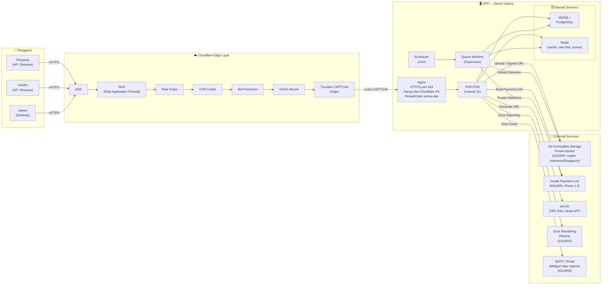

# architecture.md — JagaSewa

> Dokumen ini menggambarkan arsitektur sistem JagaSewa: diagram komponen, batas modul aplikasi, antrean & scheduler, environment, dan catatan keputusan teknis (ADR).

---

## 1. Diagram Arsitektur Sistem

> [!IMPORTANT]
> Nginx **hanya** menerima koneksi dari IP Cloudflare. Semua koneksi langsung ke IP VPS harus diblokir di level firewall OS. Ikuti dokumentasi resmi Cloudflare untuk daftar IP terkini.

---

## 2. Batas Modul Aplikasi

| Modul | Tanggung Jawab | Kelas / Namespace Utama | Tabel DB Terkait |
|---|---|---|---|
| **Booking** | Calendar logic, form publik, status transitions | `BookingCalendarService`, `BookingController` (public) | `bookings`, `renters` |
| **Identity** | Upload KTP/selfie, signed URL, auto-delete | `IdentityService`, `AutoDeleteDocumentsJob` | `identity_documents` |
| **Blacklist** | Normalisasi, HMAC hash, pencocokan | `IdentityHashService`, `BlacklistPolicy` | `blacklist_entries` |
| **Billing** | Subscription, webhook handler, entitlement check | `SubscriptionService`, `XenditWebhookHandler` | `subscriptions`, `subscription_events` |
| **Vendor Dashboard** | Filament resources, vendor auth | `Filament/Resources/*` | `vendors`, `vendor_users`, `items` |
| **Admin Panel** | Filament admin, platform config | `Filament/Admin/*` | `audit_logs`, `manual_activations` |
| **Notifications** | wa.me URL generator | `WaNotificationHelper` | *(none)* |
| **Settlement** | Fine calculation, damage items | `FineCalculatorService` | `settlements`, `damage_items` |

> [!NOTE]
> Setiap modul harus memiliki namespace yang terisolasi. Modul tidak boleh memanggil model atau service dari modul lain secara langsung — gunakan interface/contract atau event Laravel.

---

## 3. Antrean & Scheduler

| Job / Command | Trigger | Queue / Schedule | Keterangan |
|---|---|---|---|
| `AutoDeleteDocumentsJob` | Scheduler, harian 02:00 WIB | `default` queue | Hapus foto KTP/selfie yang sudah jatuh tempo dari S3 & DB |
| `AutoCancelPendingBookingsJob` | Scheduler, setiap 30 menit | `default` queue | Cancel booking dengan status `pending` > 24 jam |
| `SubscriptionReconciliationJob` | Scheduler, harian 03:00 WIB | `default` queue | Bandingkan status Xendit vs DB; deteksi ketidaksesuaian |
| `SubscriptionExpiryJob` | Scheduler, harian 00:05 WIB | `default` queue | Cek `past_due` > grace period, downgrade ke paket free |
| `ProcessWebhookJob` | Via webhook endpoint (push) | `high-priority` queue | Proses event Xendit secara async [ASUMSI] |

> [!TIP]
> Gunakan Supervisor dengan `numprocs` terpisah untuk queue `high-priority` agar webhook Xendit tidak tertunda oleh job berat. Contoh: 2 worker untuk `high-priority`, 3 worker untuk `default`.

---

## 4. Environment

| Environment | DB | Redis | Storage | Email | Payment | Debug |
|---|---|---|---|---|---|---|
| `local` | SQLite atau MySQL lokal | Opsional | Local disk | `log` driver | Mock / Sandbox | `true` |
| `staging` | MySQL / PostgreSQL staging | Redis | S3 staging bucket | Mailgun sandbox | Xendit sandbox | `false` |
| `production` | MySQL / PostgreSQL prod | Redis | S3 prod bucket | Mailgun prod | Xendit prod | `false` |

> [!IMPORTANT]
> Staging **harus** semirip mungkin dengan production untuk validasi deployment. Perbedaan konfigurasi antara staging dan production wajib didokumentasikan secara eksplisit.

> [!CAUTION]
> Jangan pernah menggunakan credential production di environment local atau staging. Gunakan `.env` terpisah per environment dan pastikan `.env` tidak pernah masuk ke version control.

---

## 5. Catatan Keputusan Teknis (ADR — Architecture Decision Records)

### ADR-01: PHP / Laravel sebagai Backend

| Field | Detail |
|---|---|
| **Status** | Diterima — MVP |
| **Keputusan** | Laravel 11 + Filament v3 + Livewire v3 |
| **Alasan** | Ekosistem matang; Filament mempercepat pembuatan dashboard vendor; Livewire menghindari kebutuhan SPA terpisah sehingga tim kecil cukup menguasai satu stack |
| **Alternatif yang ditolak** | Next.js + API backend (terlalu kompleks untuk tim kecil); Django [ASUMSI: familiar lebih sedikit di konteks ini] |

---

### ADR-02: MySQL vs PostgreSQL

| Field | Detail |
|---|---|
| **Status** | [ASUMSI] PostgreSQL direkomendasikan — keputusan akhir bergantung pada pilihan hosting |
| **Keputusan** | PostgreSQL untuk fitur `EXCLUDE USING gist` (double-booking prevention) dan `jsonb` |
| **Alasan** | `EXCLUDE USING gist` mencegah double booking lebih robust di level DB; `jsonb` lebih efisien untuk payload `audit_logs` |
| **Alternatif** | MySQL (lebih umum di shared hosting, tetapi tidak memiliki exclusion constraint — harus fallback ke `SELECT FOR UPDATE` dengan risiko deadlock lebih tinggi) |
| **Catatan** | Pilihan akhir tergantung hosting yang dipilih. Jika MySQL dipakai, wajib implementasi pessimistic locking secara eksplisit |

---

### ADR-03: ID Publik ULID / UUID bukan Integer Sequential

| Field | Detail |
|---|---|
| **Status** | Diterima — MVP |
| **Keputusan** | ULID sebagai public-facing ID di semua endpoint dan URL |
| **Alasan** | Mencegah enumerasi resource (IDOR attack surface); ULID bersifat sortable by time (keunggulan dibanding UUID v4) |
| **Alternatif yang ditolak** | UUID v4 (acak, tidak sortable, indeks lebih besar); Integer sequential (trivial untuk dienumerasi) |

---

### ADR-04: Rate Limiting di Redis bukan Database

| Field | Detail |
|---|---|
| **Status** | Diterima — MVP |
| **Keputusan** | Redis sebagai backend untuk rate limit counter (`INCR` + `EXPIRE`) |
| **Alasan** | Operasi atomik, performa tinggi, tidak membebani koneksi DB; cocok untuk spike request tinggi |
| **Alternatif yang ditolak** | Database counter (lebih lambat, rentan locking issues pada throughput tinggi) |
| **Catatan** | [ASUMSI] Jika Redis tidak tersedia, fallback ke `cache` driver database — namun ini menurunkan keandalan rate limiting |

---

### ADR-05: Webhook sebagai Sumber Kebenaran Pembayaran

| Field | Detail |
|---|---|
| **Status** | Diterima — Fase 1.5 |
| **Keputusan** | Hanya webhook Xendit yang boleh mengubah status subscription di DB; redirect browser tidak boleh mengubah status |
| **Alasan** | Browser redirect (query param `?status=paid`) dapat dimanipulasi oleh pengguna; tidak ada verifikasi server-side yang andal |
| **Catatan** | Semua webhook Xendit wajib diverifikasi signature sebelum diproses. Ikuti dokumentasi resmi Xendit untuk mekanisme signature verification |

---

### ADR-06: Blacklist Hanya Per Vendor (MVP)

| Field | Detail |
|---|---|
| **Status** | Diterima — MVP; Fase 2 untuk shared blacklist |
| **Keputusan** | Scope blacklist = private per vendor; shared blacklist antar-vendor = Fase 2 |
| **Alasan** | Risiko hukum UU PDP untuk berbagi data identitas antar-vendor; cold start problem (data belum cukup untuk shared list berguna) |
| **Mitigasi teknis** | Kolom `scope` (`vendor` / `platform`) disiapkan di tabel `blacklist_entries` sejak MVP agar ekstensi Fase 2 tidak memerlukan migrasi besar |
| **Revisi** | Fase 2 harus melalui review legal UU PDP sebelum implementasi shared blacklist |

---

*Terakhir diperbarui: lihat git log. Untuk perubahan arsitektur signifikan, buat ADR baru — jangan hapus ADR lama.*
