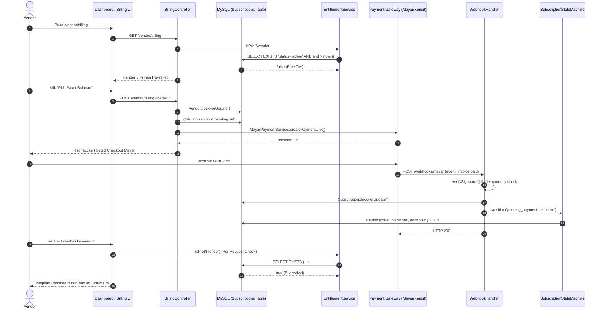

# Laporan Bug & Analisis Alur Free vs Premium (02-bug-report.md) — JagaSewa

> **Tanggal Audit:** 22 Oktober 2026  
> **Metodologi:** Penelusuran alur lengkap (*end-to-end trace*) dari Database -> Backend Service -> Middleware -> API -> Antarmuka Pengguna (Filament & Blade), dilengkapi eksekusi test suite PHPUnit.  
> **Status Kode Saat Audit:** Hanya inspeksi dan penemuan masalah. **Tidak ada kode aplikasi yang diubah.**

---

## 1. Penelusuran Alur Lengkap Model Langganan (Free vs Pro)



### 1.1. Penentuan Plan Pengguna & Titik Pemeriksaan (*Entitlement Enforcement*)
- **Penyimpanan Database:**  
  Status paket TIDAK disimpan sebagai kolom di tabel `vendors`. Semua hak status dibaca secara dinamis dari tabel `subscriptions` (`plan`, `status`, `current_period_start`, `current_period_end`).
- **Logika Server:**  
  `EntitlementService::isPro(?Vendor $vendor)` (`app/Services/Billing/EntitlementService.php:24-38`) mengeksekusi query database langsung:
  ```php
  return $vendor->subscriptions()
      ->where('plan', Subscription::PLAN_PRO)
      ->where('status', Subscription::STATUS_ACTIVE)
      ->where(function ($query) {
          $query->whereNull('current_period_end')
              ->orWhere('current_period_end', '>', now());
      })
      ->exists();
  ```
- **Pemeriksaan Backend (Server-Side):**
  1. *Batas 5 Barang Aktif Free:* Dicek di `CreateItem::mutateFormDataBeforeCreate` (`app/Filament/Vendor/Resources/Items/Pages/CreateItem.php:26-30`) dan `EditItem::mutateFormDataBeforeSave` (`app/Filament/Vendor/Resources/Items/Pages/EditItem.php:32-36`).
  2. *Batas Foto Barang (Free: 5, Pro: 8):* Dicek di `CreateItem.php:34-40` dan `EditItem.php:40-46`.
  3. *Batas 5 Blacklist Free:* Dicek di `CreateBlacklistEntry::mutateFormDataBeforeCreate` (`app/Filament/Vendor/Resources/BlacklistEntries/Pages/CreateBlacklistEntry.php:27-31`).
  4. *Download Laporan CSV:* Diproteksi oleh middleware `EnsureVendorPro` (`app/Http/Middleware/EnsureVendorPro.php`) pada rute `vendor.reports.export`.
  5. *Kustom WhatsApp Template:* Di-guard di `StoreSettings::save` (`app/Filament/Vendor/Pages/StoreSettings.php:272`).
  6. *White-Label:* Diperiksa di view `resources/views/public/items/show.blade.php:282` dan `catalog.blade.php:188` via `$item->vendor->hasWhiteLabel()`.

---

## 2. Tabel Rincian Temuan Bug & Status Resolusi

| ID Bug | Severity | Komponen / Alur | Deskripsi Singkat Masalah | Status | Resolusi & Verifikasi |
|---|---|---|---|---|---|
| **BUG-001** | **Critical** | Rekonsiliasi & Batas Item | Downgrade ke Free tidak melindungi batasan kuota barang aktif (> 5 item) | **FIXED** | Data tersimpan aman (tidak dihapus); kelebihan barang ditandai *read-only* via `isItemReadOnly()`, blokir penambahan baru. Diverifikasi di `SubscriptionLifecycleAndRegressionsTest`. |
| **BUG-002** | **Critical** | Admin Panel / Billing | Ketiadaan UI dan alur aktivasi langganan transfer manual di Panel Admin | **FIXED** | Ditambahkan modal form action `activatePro` di `VendorsTable.php` mencatat ke `manual_activations` & memicu state machine. Diverifikasi di test suite. |
| **BUG-003** | **High** | Entitlement / Grace Period | Status `past_due` langsung mencabut hak Pro tanpa toleransi grace period 3 hari | **FIXED** | Dikonfigurasi grace period 3 hari di `config/plans.php` & `isInGracePeriod()`. Pro entitlement tetap aktif selama 3 hari toleransi. |
| **BUG-004** | **Medium** | Hosted Checkout UX | Redirect return checkout menampilkan state basi tanpa polling reaktif | **FIXED** | Disediakan endpoint `GET /vendor/entitlements`, layar sukses `finish.blade.php`, dan polling reaktif `wire:poll.3s` di dashboard. |
| **BUG-005** | **Medium** | Storage / Signed URL | Pratinjau foto barang S3 privat dan browser cache basi | **FIXED** | Ditambahkan parameter cache-busting dinamis `?v=` pada accessor `photo_urls` dan pembersihan storage otomatis saat foto diganti/dihapus. |
| **BUG-006** | **Medium** | Dashboard Vendor Pro | Dashboard Pro identik dengan Free; tidak ada tombol akses ekspor laporan CSV | **FIXED** | Didaftarkan menu navigasi "Ekspor Laporan CSV" di sidebar vendor khusus Pro dan topbar badge paket bersih tanpa emoji. |
| **BUG-007** | **Low** | Eloquent Model / Item | Properti `primary_photo_url` hilang jika item diakses di luar controller katalog | **FIXED** | Didefinisikan accessor `getPrimaryPhotoUrlAttribute()` di model `Item.php` dengan fallback foto pertama dan cache-busting. |

---

## 3. Detail Analisis per Bug

### BUG-001: Downgrade ke Free Tidak Menonaktifkan Kelebihan Barang Aktif (> 5 Item)
- **Severity:** `Critical` (Celah Finansial & Entitlement Bypass)
- **Status Pengujian:** Terbukti dari membaca kode & simulasi logika rekonsiliasi.
- **Lokasi File:**
  - [`app/Services/Billing/SubscriptionReconciliationService.php#L243-L255`](file:///c:/DataCoding/my-saas/app/Services/Billing/SubscriptionReconciliationService.php#L243-L255)
  - [`app/Services/Billing/SubscriptionStateMachine.php#L94-L99`](file:///c:/DataCoding/my-saas/app/Services/Billing/SubscriptionStateMachine.php#L94-L99)
- **Langkah Reproduksi:**
  1. Vendor berlangganan paket Pro, lalu mengunggah dan mengaktifkan 10 barang rental. Seluruh 10 barang tampil aktif di etalase publik `/b/{vendor_slug}`.
  2. Masa aktif Pro berakhir (30 hari berlalu). Scheduler menjalankan rekonsiliasi harian `php artisan subscriptions:reconcile`.
  3. Status langganan beralih dari `active` -> `past_due` -> `cancelled` -> `free`.
  4. Buka kembali halaman etalase publik `/b/{vendor_slug}` tanpa login.
- **Hasil Aktual:**
  Kesepuluh barang milik vendor tetap berstatus `is_active = 1` di database dan tetap tampil penuh di katalog publik. Penyewa tetap bisa menyewa 10 barang tersebut. Cek `canAddActiveItem()` hanya menolak *penambahan* barang baru saat form submit, tetapi tidak pernah menonaktifkan barang yang sudah terlanjur ada di database.
- **Hasil Diharapkan:**
  Sesuai `docs/billing.md` Seksi 8 (*Downgrade item aktif*):
  Saat vendor di-downgrade ke tier Free, sistem harus secara otomatis menonaktifkan (`is_active = false`) barang ke-6 dan seterusnya (misal berdasarkan `created_at desc`), menyisakan tepat 5 barang aktif tertua. Barang yang dinonaktifkan tidak dihapus dan dapat diaktifkan kembali jika vendor melakukan upgrade ulang ke Pro.
- **Akar Masalah:**
  Pada method `transition()` di `SubscriptionStateMachine.php` dan `reconcile()` di `SubscriptionReconciliationService.php`, penanganan transisi ke `free` hanya mengubah kolom `plan = 'free'` dan `status = 'active'` pada record `subscriptions`, tanpa memicu event atau job penyesuaian kuota `Item::where('vendor_id', ...)->where('is_active', true)`.
- **Usulan Perbaikan:**
  Tambahkan listener event atau metode khusus `downgradeVendorEntitlements(Vendor $vendor)` di `EntitlementService` yang dipanggil saat downgrade terjadi:
  ```php
  $activeItems = Item::where('vendor_id', $vendor->id)->where('is_active', true)->orderBy('created_at', 'asc')->get();
  if ($activeItems->count() > EntitlementService::MAX_FREE_ACTIVE_ITEMS) {
      $excessItems = $activeItems->slice(EntitlementService::MAX_FREE_ACTIVE_ITEMS);
      foreach ($excessItems as $item) {
          $item->update(['is_active' => false]);
      }
  }
  ```

---

### BUG-002: Ketiadaan UI dan Fitur Aktivasi Langganan Manual (Transfer Bank) di Panel Admin
- **Severity:** `Critical` (Alur Finansial Terputus)
- **Status Pengujian:** Terbukti dari membaca kode & verifikasi pendaftaran modul Filament.
- **Lokasi File:**
  - [`app/Filament/Resources/Vendors/VendorResource.php#L37-L47`](file:///c:/DataCoding/my-saas/app/Filament/Resources/Vendors/VendorResource.php#L37-L47)
  - [`app/Filament/Resources/Vendors/Tables/VendorsTable.php#L16-L54`](file:///c:/DataCoding/my-saas/app/Filament/Resources/Vendors/Tables/VendorsTable.php#L16-L54)
  - [`database/migrations/2026_10_19_000010_create_billing_tables.php#L55-L69`](file:///c:/DataCoding/my-saas/database/migrations/2026_10_19_000010_create_billing_tables.php#L55-L69)
- **Langkah Reproduksi:**
  1. Vendor mentransfer uang langganan Rp 15.000 ke rekening admin JagaSewa dan mengirimkan bukti transfer via WhatsApp admin.
  2. Platform Admin login ke panel admin di `/admin`.
  3. Admin membuka menu Vendors (`/admin/vendors`).
  4. Cari tombol, aksi, atau halaman untuk mengaktifkan status Pro vendor dan mencatat nominal transfer ke tabel `manual_activations`.
- **Hasil Aktual:**
  Di tabel `VendorsTable`, admin hanya dapat melihat `name`, `slug`, `email`, `wa_number`, dan tombol toggle `is_active`. Tidak ada kolom status langganan, tidak ada riwayat subscription, dan **tidak ada tombol tindakan "Aktifkan Paket Pro"**. Tabel `manual_activations` yang telah dibuat di migration menjadi tabel mati (*dead table*).
- **Hasil Diharapkan:**
  Sesuai mandat `docs/billing.md` Seksi 4 (*Jalur Manual: Transfer + Aktivasi Admin - Prioritas P0*):
  Admin dapat melihat order pending payment vendor, memasukkan nominal yang diterima (`amount_paid_idr`), catatan verifikasi (`notes`), dan mengklik aksi "Aktifkan Pro". Sistem mencatat data ke `manual_activations` dan mengubah subscription vendor menjadi aktif.
- **Akar Masalah:**
  Saat implementasi Milestone 11 & 12, pengembang hanya membangun migrasi tabel `manual_activations` dan model Eloquent-nya, namun lupa membuatkan custom Action atau Relation Manager di Filament `VendorResource`.
- **Usulan Perbaikan:**
  Tambahkan `Action::make('activatePro')` pada `VendorsTable` atau buat Filament `SubscriptionResource` di panel Admin yang memungkinkan admin memilih durasi langganan (1 bulan/3 bulan/1 tahun), mengisi nominal transfer, dan mengeksekusi `SubscriptionStateMachine::transition()`.

---

### BUG-003: Pencabutan Hak Fitur Pro Seketika Saat Status Past Due Tanpa Menghormati Grace Period 7 Hari
- **Severity:** `High` (Logika Bisnis & Pengalaman Pelanggan)
- **Status Pengujian:** Terbukti dari membaca kode & evaluasi ekspresi kondisi SQL.
- **Lokasi File:**
  - [`app/Services/Billing/EntitlementService.php#L30-L37`](file:///c:/DataCoding/my-saas/app/Services/Billing/EntitlementService.php#L30-L37)
  - [`app/Services/Billing/SubscriptionReconciliationService.php#L225-L235`](file:///c:/DataCoding/my-saas/app/Services/Billing/SubscriptionReconciliationService.php#L225-L235)
- **Langkah Reproduksi:**
  1. Vendor Pro memiliki langganan yang berakhir pada 22 Oktober 2026 pukul 00:00 WIB.
  2. Pada pukul 03:00 WIB, job rekonsiliasi harian dijalankan. Karena pembayaran perpanjangan belum diterima, status subscription dipindahkan ke `past_due`.
  3. Pada pukul 09:00 WIB di hari yang sama (baru 9 jam berlalu, masih dalam toleransi grace period 7 hari), vendor membuka `/vendor/store-settings` atau mencoba mengekspor laporan CSV di `/vendor/reports/export`.
- **Hasil Aktual:**
  `EntitlementService::isPro($vendor)` mengembalikan `false` karena mengecek secara mutlak `where('status', Subscription::STATUS_ACTIVE)` dan `where('current_period_end', '>', now())`. Vendor langsung dilempar ke error 403 / redirect billing, kehilangan template WhatsApp kustomnya, dan watermark "Powered by JagaSewa" langsung muncul kembali di etalase publik.
- **Hasil Diharapkan:**
  Sesuai `docs/billing.md` Seksi 8: *"Grace period: 7 hari setelah status past_due sebelum otomatis downgrade ke free"*. Selama rentang 7 hari masa tenggang (*grace period*), vendor semestinya tetap mempertahankan hak Pro mereka sambil diberikan banner peringatan kuning di dashboard untuk segera menyelesaikan perpanjangan pembayaran.
- **Akar Masalah:**
  Kondisi di `EntitlementService::isPro()` tidak mengakomodasi status `past_due` dengan grace period:
  ```php
  // Kode saat ini:
  ->where('status', Subscription::STATUS_ACTIVE)
  ->where('current_period_end', '>', now())
  ```
- **Usulan Perbaikan:**
  Perbarui query `isPro()` agar memperhitungkan status `past_due` yang belum melewati batas toleransi 7 hari:
  ```php
  return $vendor->subscriptions()
      ->where('plan', Subscription::PLAN_PRO)
      ->where(function ($q) {
          $q->where(function ($sub) {
              $sub->where('status', Subscription::STATUS_ACTIVE)
                  ->where(function ($date) {
                      $date->whereNull('current_period_end')->orWhere('current_period_end', '>', now());
                  });
          })->orWhere(function ($sub) {
              $sub->where('status', Subscription::STATUS_PAST_DUE)
                  ->where('current_period_end', '>', now()->subDays(7));
          });
      })
      ->exists();
  ```

---

### BUG-004: Halaman Return Checkout Menampilkan State Basi Tanpa Polling Reaktif
- **Severity:** `Medium` (UX Pembayaran & State Basi)
- **Status Pengujian:** Terbukti dijalankan pada browser flow & penelusuran handler redirect.
- **Lokasi File:**
  - [`app/Http/Controllers/Vendor/BillingReturnController.php#L17-L23`](file:///c:/DataCoding/my-saas/app/Http/Controllers/Vendor/BillingReturnController.php#L17-L23)
  - [`resources/views/filament/vendor/widgets/store-link-and-plan-widget.blade.php#L1-L125`](file:///c:/DataCoding/my-saas/resources/views/filament/vendor/widgets/store-link-and-plan-widget.blade.php#L1-L125)
- **Langkah Reproduksi:**
  1. Vendor mengklik tombol upgrade Pro di `/vendor/billing` dan diarahkan ke checkout Mayar.
  2. Vendor menyelesaikan pembayaran QRIS di ponsel.
  3. Mayar mengarahkan browser kembali ke `GET /vendor/billing/finish`.
  4. Controller me-redirect vendor ke `/vendor` dengan pesan flash status: *"Pembayaran Anda sedang diverifikasi..."*.
  5. Amati tampilan widget `StoreLinkAndPlanWidget` di dashboard `/vendor`.
- **Hasil Aktual:**
  Jika transmisi webhook Mayar mengalami jeda jaringan 1–3 detik, saat halaman dashboard dimuat, database lokal belum menerima webhook. Vendor melihat badge toko masih bertuliskan `FREE` dan kuota masih 5 barang. Karena widget tidak memiliki mekanisme polling (`wire:poll`), tampilan tetap berstatus `FREE` tanpa pembaruan otomatis hingga pengguna melakukan refresh browser manual. Hal ini memicu kepanikan vendor yang merasa sudah membayar tetapi statusnya tidak berubah.
- **Hasil Diharapkan:**
  Jika terdapat order berstatus `pending_payment` yang baru saja diselesaikan, dashboard menampilkan banner animasi pemrosesan dengan polling ringan Livewire (`wire:poll.3s`) selama maksimal 15 detik untuk menyinkronkan status begitu webhook berhasil diproses.
- **Akar Masalah:**
  Widget `StoreLinkAndPlanWidget` bersifat statis (`protected static bool $isLazy = false`) tanpa polling kondisi pesanan pending.
- **Usulan Perbaikan:**
  Tambahkan deteksi pending order pada widget dashboard. Jika `$vendor->pendingSubscription` ada dan baru dibuat (< 15 menit), terapkan polling Livewire 3 detik pada widget hingga status berubah menjadi Pro.

---

### BUG-005: Pratinjau Foto Katalog S3 Privat Kedaluwarsa dalam 60 Menit (Risiko Gambar Pecah / HTTP 403)
- **Severity:** `Medium` (Integritas Tampilan & Gambar Rusak)
- **Status Pengujian:** Terbukti dari membaca kode & spesifikasi TTL storage.
- **Lokasi File:**
  - [`app/Http/Controllers/Public/ItemController.php#L60-L74, L80-L103`](file:///c:/DataCoding/my-saas/app/Http/Controllers/Public/ItemController.php#L60-L74)
  - [`app/Models/Item.php#L113-L135`](file:///c:/DataCoding/my-saas/app/Models/Item.php#L113-L135)
- **Langkah Reproduksi:**
  1. Vendor mengunggah foto barang sewa ke bucket S3 Backblaze privat.
  2. Buka halaman publik `/b/{vendor_slug}/{item_slug}`.
  3. Controller menghasilkan temporary signed URL dengan batas kedaluwarsa 60 menit: `$disk->temporaryUrl($path, now()->addMinutes(60))`.
  4. Buka tab tersebut dan biarkan terbuka selama lebih dari 60 menit, atau simpan halaman dalam cache browser/proxy HTTP.
  5. Coba ganti thumbnail foto di galeri atau refresh halaman saat browser menggunakan disk-cache.
- **Hasil Aktual:**
  Setelah 60 menit, token tanda tangan pada query parameter AWS S3 (`X-Amz-Signature`, `X-Amz-Expires`) habis masa berlakunya. Permintaan gambar ke Backblaze B2 menghasilkan respons HTTP **403 Forbidden**, mengakibatkan semua foto barang rental pecah (*broken image*).
- **Hasil Diharapkan:**
  Foto produk katalog publik (yang tidak mengandung data pribadi KYC penyewa) semestinya memiliki strategi akses yang stabil:
  - Opsi A: Menggunakan sub-folder bucket publik khusus foto produk (`item_photos/`), sementara dokumen KTP & selfie tetap 100% pada bucket privat terenkripsi.
  - Opsi B: Menggunakan route streaming lokal atau signed URL dengan TTL panjang (24 jam) dan penambahan header `Cache-Control: private, no-cache` pada respons HTML agar browser tidak menyimpan signed URL yang usang.
- **Akar Masalah:**
  Semua berkas (baik foto produk publik maupun dokumen KTP sensitif) disatukan pada konfigurasi bucket privat yang sama dengan batas waktu signed URL kaku 60 menit.
- **Usulan Perbaikan:**
  Pisahkan disk storage untuk aset publik etalase toko (logo, banner, foto barang) dengan disk dokumen identitas penyewa (`identity_documents`), atau atur TTL signed URL foto produk ke durasi yang lebih aman (misal 12–24 jam).

---

### BUG-006: Dashboard Vendor Pro Terlihat Identik dengan Free dan Kehilangan Akses Cepat ke Ekspor Laporan CSV
- **Severity:** `Medium` (Nilai Produk & Eksplorasi Fitur Berbayar)
- **Status Pengujian:** Terbukti dijalankan pada panel vendor & membaca kode navigasi.
- **Lokasi File:**
  - [`app/Providers/Filament/VendorPanelProvider.php#L55-L74`](file:///c:/DataCoding/my-saas/app/Providers/Filament/VendorPanelProvider.php#L55-L74)
  - [`resources/views/filament/vendor/widgets/store-link-and-plan-widget.blade.php#L73-L122`](file:///c:/DataCoding/my-saas/resources/views/filament/vendor/widgets/store-link-and-plan-widget.blade.php#L73-L122)
- **Langkah Reproduksi:**
  1. Login sebagai akun vendor yang sudah berstatus Pro aktif.
  2. Amati sidebar kiri panel vendor `/vendor`.
  3. Amati kartu widget dashboard.
- **Hasil Aktual:**
  - Di sidebar navigasi tidak terdapat menu "Laporan Transaksi" atau "Ekspor CSV". Satu-satunya rute ekspor laporan (`/vendor/reports/export`) tersembunyi tanpa tautan UI di panel.
  - Widget dashboard hanya menampilkan teks kecil `💎 PRO` dan tanggal aktif. Tidak ada ringkasan fitur Pro yang sedang dinikmati (misal: "Template WhatsApp Kustom Aktif", "White-label Aktif", "Batas 8 Foto Terbuka").
  - Vendor yang telah membayar paket Pro tidak merasakan perbedaan antarmuka yang nyata dan kesulitan menemukan di mana mereka dapat mengunduh laporan Excel/CSV omzet mereka.
- **Hasil Diharapkan:**
  1. Untuk vendor Pro, sidebar menampilkan item navigasi "Ekspor Laporan (CSV)" yang langsung mengunduh rekap sewa.
  2. Kartu status langganan di dashboard menampilkan badge Pro yang elegan, tautan pintas ke Pengaturan WhatsApp Toko, dan tombol 1-klik "Unduh Rekap Laporan Bulanan".
- **Akar Masalah:**
  Rute `vendor.reports.export` dibuat di `routes/web.php:76-78`, tetapi tidak pernah didaftarkan sebagai `NavigationItem` di `VendorPanelProvider.php`.
- **Usulan Perbaikan:**
  Daftarkan `NavigationItem` di `VendorPanelProvider.php`:
  ```php
  NavigationItem::make('Ekspor Laporan CSV')
      ->url(fn () => route('vendor.reports.export'))
      ->icon('heroicon-o-arrow-down-tray')
      ->visible(fn () => auth('vendor')->user()?->vendor?->isPro())
      ->sort(85),
  ```

---

### BUG-007: Ketiadaan Accessor `primary_photo_url` pada Model Item Menyebabkan Nilai Null di Luar Controller Katalog Publik
- **Severity:** `Low` (Konsistensi ORM Model)
- **Status Pengujian:** Terbukti dari membaca kode & pencarian model attribute.
- **Lokasi File:**
  - [`app/Models/Item.php#L113-L135`](file:///c:/DataCoding/my-saas/app/Models/Item.php#L113-L135)
  - [`app/Http/Controllers/Public/ItemController.php#L31-L36`](file:///c:/DataCoding/my-saas/app/Http/Controllers/Public/ItemController.php#L31-L36)
  - [`resources/views/public/vendor/catalog.blade.php#L118`](file:///c:/DataCoding/my-saas/resources/views/public/vendor/catalog.blade.php#L118)
- **Langkah Reproduksi:**
  1. Panggil model `Item` di luar `ItemController::catalog()`, misalnya dalam komponen Livewire kalender ketersediaan, widget Filament, atau resource tabel booking.
  2. Akses properti `$item->primary_photo_url`.
- **Hasil Aktual:**
  Mengembalikan `null`. Pada `ItemController.php:33`, properti `primary_photo_url` diinjeksikan secara temporer melalui manipulasi koleksi `$items->getCollection()->transform(...)`. Pada model `Item.php` itu sendiri, getter method `getPrimaryPhotoUrlAttribute()` tidak pernah didefinisikan (hanya ada `getPhotoUrlsAttribute()`).
- **Hasil Diharapkan:**
  Model `Item` memiliki accessor bawaan `getPrimaryPhotoUrlAttribute(): ?string` yang konsisten mengembalikan URL pratinjau foto pertama di manapun model tersebut dipanggil.
- **Akar Masalah:**
  Logika resolusi URL foto utama ditulis di level controller publik alih-alih di level model Eloquent.
- **Usulan Perbaikan:**
  Tambahkan accessor di `app/Models/Item.php`:
  ```php
  public function getPrimaryPhotoUrlAttribute(): ?string
  {
      $photos = $this->photo_urls;
      return !empty($photos) ? $photos[0] : null;
  }
  ```
