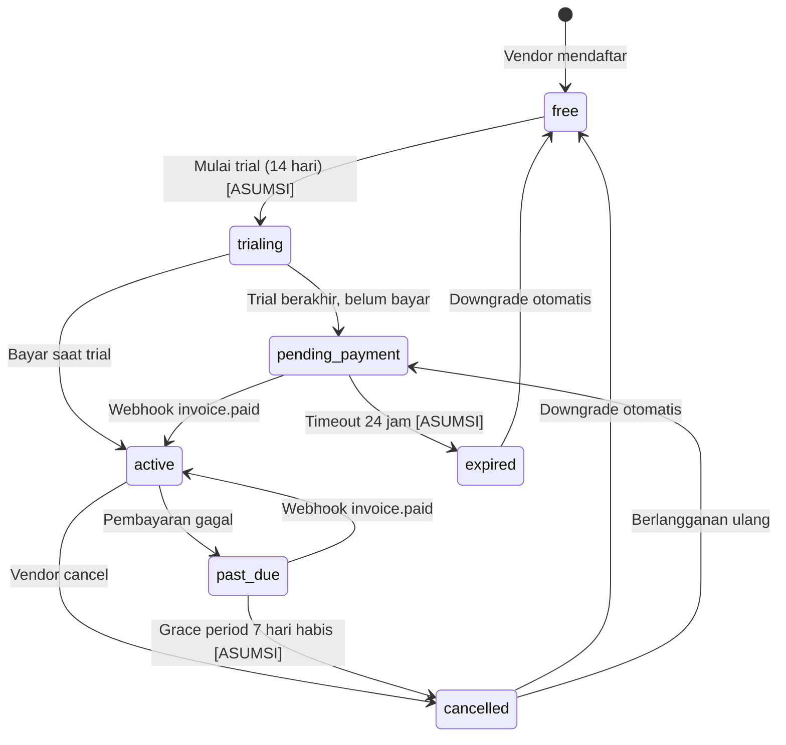

# billing.md — JagaSewa

> Dokumen ini mencakup **billing langganan vendor ke JagaSewa** (bukan pembayaran renter ke vendor — itu di luar sistem).
> **Fase: 1.5** (setelah MVP selesai dan stabil).

---

## 1. Paket & Batas Fitur (Model Freemium Opsi B)

> [!IMPORTANT]
> Entitlement **harus dicek di server setiap request**, tidak boleh diambil dari session atau cookie.

| Fitur | 🟢 Free (Mulai Rental) | 💎 Pro (Tumbuh & Aman) | Dampak bagi Vendor |
|---|---|---|---|
| **Jumlah item aktif** | **Maksimal 5 item** | **Unlimited (Tanpa Batas)** | **Hook Upgrade:** Cukup untuk 5 barang terlaris. Saat barang ke-6 ditambah, upgrade ke Pro terjadi secara alami. |
| **Smart Buffer Calendar** | ✅ Otomatis (jeda cuci/kirim) | ✅ Otomatis (jeda cuci/kirim) | Mencegah jadwal bentrok tanpa biaya. Kunci retensi vendor. |
| **Form booking publik & KYC KTP** | ✅ Lengkap (watermark + signed URL) | ✅ Lengkap (watermark + signed URL) | Perlindungan aset dari risiko penipuan/barang dibawa kabur. |
| **Branding Toko (Katalog Web)** | Terdapat watermark *"Powered by JagaSewa"* | **White-label (Bersih tanpa watermark)** | **Gengsi Brand:** Tampilan katalog terlihat seperti website resmi & eksklusif milik vendor sendiri. |
| **Kustomisasi Pesan WhatsApp** | Template chat standar sistem | **Bebas kustom template WhatsApp** | **Hemat Waktu:** Bisa masukkan nomor rekening toko, alamat pengembalian, aturan denda, dan sapaan khas brand. |
| **Blacklist Pribadi & Catatan Risiko** | Maksimal 5 entri | **Unlimited entri + Catatan riwayat risiko penyewa** | Catatan internal untuk menandai penyewa bermasalah/pernah merusak barang. |
| **Jumlah Foto per Barang** | Maksimal 2 foto | **Maksimal 6–8 foto per barang** | Vendor kostum/kamera bisa memamerkan printilan wig, aksesoris, sepatu, atau bodi & lensa. |
| **Ekspor Data & Laporan** | ❌ (Hanya ringkasan visual dashboard) | **✅ Download laporan Excel / CSV** | Sekali klik untuk rekap omzet sewa, deposit, dan denda bulanan untuk pembukuan. |
| **Prioritas Support** | Komunitas / Email | WhatsApp Admin langsung | Bantuan cepat jika ada kendala operasional. |
| **Pilihan Harga Langganan** | **Rp 0 / selamanya** | **• Bulanan:** **Rp 15.000 / bulan**<br>**• 3 Bulan (Hemat):** **Rp 39.000 / 3 bln** *(Rp 13.000/bln)*<br>**• 1 Tahun (Super Hemat):** **Rp 129.000 / thn** *(Rp 10.750/bln)* | Harga mikro impulsif (seharga segelas es teh/gorengan). 1x sewa barang sudah menutup biaya langganan sebulan penuh. |

---

## 2. Entitas Database Billing

> [!NOTE]
> Tabel-tabel berikut perlu ditambahkan ke ERD utama. Koordinasikan dengan `erd.md`.

### Tabel `subscriptions`

| Kolom | Tipe | Keterangan |
|---|---|---|
| `id` | ULID / UUID | Primary key (bukan sequential) |
| `vendor_id` | FK → vendors | Pemilik langganan |
| `plan` | ENUM(`free`, `premium`) | Paket aktif |
| `status` | ENUM(`active`, `past_due`, `cancelled`, `trialing`, `pending_payment`, `expired`) | Status saat ini |
| `current_period_start` | TIMESTAMP (Asia/Jakarta) | Awal periode aktif |
| `current_period_end` | TIMESTAMP (Asia/Jakarta) | Akhir periode aktif |
| `gateway_subscription_id` | VARCHAR, nullable | ID langganan di gateway |
| `gateway_customer_id` | VARCHAR, nullable | ID customer di gateway |
| `created_at` | TIMESTAMP | — |
| `updated_at` | TIMESTAMP | — |

### Tabel `subscription_events`

| Kolom | Tipe | Keterangan |
|---|---|---|
| `id` | ULID / UUID | Primary key |
| `subscription_id` | FK → subscriptions | — |
| `vendor_id` | FK → vendors | Denormalized untuk audit |
| `event_type` | VARCHAR | Contoh: `invoice.paid`, `invoice.expired` |
| `gateway_event_id` | VARCHAR, **UNIQUE** | Untuk idempotency — tolak duplikat |
| `payload_hash` | VARCHAR | Hash payload (tanpa PII) |
| `amount_idr` | BIGINT (integer rupiah) | Nominal transaksi |
| `status` | VARCHAR | Status akhir event |
| `processed_at` | TIMESTAMP | Waktu event diproses |
| `created_at` | TIMESTAMP | — |

### Tabel `manual_activations`

| Kolom | Tipe | Keterangan |
|---|---|---|
| `id` | ULID / UUID | Primary key |
| `subscription_id` | FK → subscriptions | — |
| `vendor_id` | FK → vendors | — |
| `activated_by` | FK → users (admin) | Admin yang mengaktifkan |
| `amount_paid_idr` | BIGINT (integer rupiah) | Nominal yang diterima |
| `notes` | TEXT, nullable | Catatan verifikasi admin |
| `activated_at` | TIMESTAMP | Waktu aktivasi manual |

---

## 3. State Machine Langganan

### Tabel Transisi

| Status Asal | Status Tujuan | Pemicu |
|---|---|---|
| *(baru)* | `free` | Vendor mendaftar |
| `free` | `trialing` | Vendor mulai trial (14 hari) [ASUMSI] |
| `trialing` | `pending_payment` | Trial berakhir, belum bayar |
| `trialing` | `active` | Bayar saat masa trial |
| `pending_payment` | `active` | Webhook `invoice.paid` diterima |
| `pending_payment` | `expired` | Timeout 24 jam tanpa pembayaran [ASUMSI] |
| `active` | `past_due` | Pembayaran perpanjangan gagal |
| `active` | `cancelled` | Vendor membatalkan langganan |
| `past_due` | `active` | Webhook `invoice.paid` berhasil |
| `past_due` | `cancelled` | Grace period 7 hari habis [ASUMSI] |
| `cancelled` | `free` | Downgrade otomatis setelah cancel |
| `cancelled` | `pending_payment` | Vendor berlangganan ulang |
| `expired` | `free` | Downgrade otomatis setelah expired |

### Diagram State Machine



> [!WARNING]
> State machine harus menolak transisi yang tidak terdaftar di tabel di atas. Log dan alert jika ada transisi tidak valid yang dicoba.

---

## 4. Jalur Manual (Transfer + Aktivasi Admin)

**Prioritas: P0 untuk Fase 1.5** — jalur ini harus selesai sebelum jalur gateway.

| Langkah | Aktor | Aksi |
|---|---|---|
| 1 | Vendor | Pilih paket Premium di dashboard → sistem membuat order di DB (`status: pending_payment`) |
| 2 | Vendor | Transfer ke rekening JagaSewa (nomor rekening ditampilkan di halaman order) |
| 3 | Vendor | Kirim bukti transfer via upload di dashboard atau WA ke admin |
| 4 | Admin | Verifikasi bukti transfer di dashboard admin |
| 5 | Admin | Tekan **'Aktifkan Premium'** → sistem mencatat ke `manual_activations` → `subscription.status` → `active` |
| 6 | Sistem | Audit log dicatat; notifikasi WA dikirim ke vendor |

> [!NOTE]
> Jika nominal tidak cocok, admin **tidak boleh** mengaktifkan — catat di `notes` dan hubungi vendor.

---

## 5. Jalur Gateway (Xendit [ASUMSI])

> [!NOTE]
> [ASUMSI] Provider yang dipilih adalah **Xendit**. Alternatif yang dipertimbangkan: **Midtrans**. Keduanya mendukung hosted checkout dan webhook. Ikuti dokumentasi resmi masing-masing provider untuk detail parameter API.

**Prioritas: P1 untuk Fase 1.5** — diimplementasikan setelah jalur manual stabil.

| Langkah | Aktor | Aksi |
|---|---|---|
| 1 | Vendor | Tekan **'Langganan Premium'** → server membuat invoice/payment link via Xendit API |
| 2 | Vendor | Diarahkan ke hosted checkout Xendit (data kartu/rekening **tidak pernah** menyentuh server JagaSewa) |
| 3 | Vendor | Browser redirect kembali ke JagaSewa setelah checkout |
| 4 | Xendit | Mengirim webhook ke `POST /webhooks/xendit` |
| 5 | Sistem | Webhook handler memproses (lihat Seksi 6) |

> [!CAUTION]
> **JANGAN** gunakan redirect browser sebagai sumber kebenaran status pembayaran. Redirect hanya untuk UX. Sumber kebenaran tunggal adalah webhook (Seksi 6).

---

## 6. Webhook Handler — Urutan Langkah

**Endpoint:** `POST /webhooks/xendit` [ASUMSI]

> Ikuti dokumentasi resmi Xendit untuk format header signature dan cara verifikasinya.

| # | Langkah | Detail |
|---|---|---|
| 1 | **Verifikasi signature** | Cek token/header signature sesuai dokumentasi resmi Xendit [ASUMSI]. Tolak jika tidak valid → HTTP **401**, catat log. |
| 2 | **Parse payload** | Ekstrak: `event_type`, `external_id` / `order_id`, `amount`, `currency`, `status`. |
| 3 | **Cek idempotency** | `SELECT * FROM subscription_events WHERE gateway_event_id = :received_id`. Jika sudah ada → return HTTP **200** (sudah diproses sebelumnya). |
| 4 | **Validasi bisnis** | Nominal cocok dengan order di DB (integer IDR), `currency = IDR`, `order_id` milik vendor yang benar. Jika gagal → ROLLBACK, alert admin. |
| 5 | **Kunci baris** | `BEGIN TRANSACTION; SELECT ... FROM subscriptions FOR UPDATE WHERE id = :subscription_id` |
| 6 | **Jalankan state machine** | Terapkan transisi berdasarkan `event_type`. Tolak jika transisi tidak valid. |
| 7 | **Simpan event** | `INSERT INTO subscription_events (gateway_event_id, payload_hash, ...)` |
| 8 | **Commit** | `COMMIT` |
| 9 | **Respond** | Return HTTP **200** |
| 10 | **Error handling** | Jika error di langkah 4–8: `ROLLBACK`, return HTTP **500** → Xendit akan melakukan retry otomatis. |

> [!CAUTION]
> Langkah 5 (`FOR UPDATE`) wajib untuk mencegah race condition jika webhook dikirim berulang secara paralel.

---

## 7. Idempotensi & Rekonsiliasi

| Mekanisme | Detail |
|---|---|
| **Idempotency webhook** | `gateway_event_id` memiliki constraint `UNIQUE` di `subscription_events`. Cek sebelum memproses — jika sudah ada, return 200 tanpa proses ulang. |
| **Rekonsiliasi harian** | Job terjadwal (cron harian) membandingkan status langganan di Xendit API vs data di DB. Alert ke admin jika ada ketidakcocokan. [ASUMSI] |
| **Alert webhook terlambat** | Alert ke admin jika webhook tidak diterima dalam **30 menit** setelah order berstatus `pending_payment`. [ASUMSI] |

> [!TIP]
> Simpan `payload_hash` (bukan payload mentah) di `subscription_events` untuk audit tanpa menyimpan PII sensitif dari gateway.

---

## 8. Grace Period & Downgrade

| Kebijakan | Detail |
|---|---|
| **Grace period** | 7 hari setelah status `past_due` sebelum otomatis downgrade ke `free`. [ASUMSI] |
| **Downgrade item aktif** | Jumlah item aktif dikurangi ke batas paket Free (maksimal 5 item). Item kelebihan di-*disable* otomatis (tidak dihapus dari DB). Vendor dapat mengaktifkannya kembali setelah upgrade ke Pro. |
| **Notifikasi** | Notifikasi WA dikirim ke vendor **3 hari sebelum** `current_period_end` expired. [ASUMSI] |

> [!IMPORTANT]
> Downgrade **tidak menghapus data** vendor. Hanya menonaktifkan akses fitur Pro dan membatasi jumlah item aktif ke maksimal 5 item.

---

## 9. Refund & Sengketa [ASUMSI]

| Situasi | Kebijakan |
|---|---|
| **Refund** | Manual oleh admin melalui dashboard. Tidak ada otomasi refund di Fase 1.5. [ASUMSI] |
| **Sengketa** | Vendor menghubungi admin via WA. Admin memutuskan secara manual dan mencatat di `manual_activations.notes`. [ASUMSI] |
| **Partial payment** | Ditolak. Pembayaran harus lunas untuk aktivasi. Jika nominal tidak cocok, admin tidak mengaktifkan dan menghubungi vendor. [ASUMSI] |

---

## 10. Pengecekan Entitlement di Server

```
subscription.status == 'active'
  AND subscription.current_period_end >= NOW() -- Asia/Jakarta
```

| Aturan | Detail |
|---|---|
| **Jangan cache di session/cookie** | Entitlement tidak boleh disimpan di sisi klien. |
| **Cache Redis (opsional)** | Boleh cache hasil cek entitlement di Redis dengan TTL maksimal **5 menit**. [ASUMSI] Setelah TTL, query ulang ke DB. |
| **Setiap request** | Setiap endpoint/fitur yang memerlukan Pro/Premium harus menjalankan cek ini, bukan hanya saat login. |
| **Downgrade efektif segera** | Begitu status berubah (oleh webhook atau job), entitlement berubah pada cek berikutnya (max 5 menit delay jika Redis aktif). |

---

## 11. Tabel Kasus Uji Billing

| ID | Skenario | Input | Langkah | Hasil Yang Diharapkan |
|---|---|---|---|---|
| BLT-01 | Webhook ganda (replay) | Xendit mengirim event yang sama dua kali dengan `gateway_event_id` sama | Handler menerima webhook ke-2 → cek `subscription_events` | Duplikat dideteksi → return HTTP 200 tanpa proses ulang; status tidak berubah |
| BLT-02 | Webhook terlambat | Webhook `invoice.paid` diterima 2 jam setelah payment, order belum expired | Handler memproses webhook | Status berhasil diubah ke `active`; event dicatat dengan `processed_at` aktual |
| BLT-03 | Webhook tidak berurutan | `invoice.paid` diterima sebelum order dibuat di sisi JagaSewa | Handler mencari order → tidak ditemukan atau status tidak kompatibel | State machine menolak transisi tidak valid; return HTTP 200 dengan log error; alert admin |
| BLT-04 | Nominal tidak cocok | Transfer Rp 10.000; seharusnya Rp 15.000 | Handler memvalidasi `amount` vs order di DB | Validasi gagal → ROLLBACK; alert admin; status tetap `pending_payment` |
| BLT-05 | Replay attack (signature sama) | Attacker mengirim ulang webhook valid yang sudah diproses | Handler verifikasi signature (lolos) → cek `gateway_event_id` | Idempotency check mendeteksi duplikat → return HTTP 200; tidak ada perubahan status |
| BLT-06 | Race condition redirect vs webhook | Browser redirect datang sebelum webhook Xendit | Redirect endpoint dipanggil; webhook belum sampai | Redirect **tidak** mengubah status subscription; status hanya berubah saat webhook diproses |
| BLT-07 | Order expired, webhook terlambat | Vendor tidak bayar dalam 24 jam → status `expired`; webhook `invoice.paid` datang setelah expired | Handler menerima webhook → cek status order | State machine menolak transisi dari `expired` → `active`; return HTTP 200; alert admin untuk investigasi manual |
| BLT-08 | Signature webhook salah | Request ke `/webhooks/xendit` dengan header signature yang tidak valid | Handler memverifikasi signature | Signature gagal → HTTP **401**; payload tidak diproses; event dicatat di log keamanan |
| BLT-09 | Pembayaran sebagian | Vendor transfer Rp 10.000 dari total Rp 15.000; gateway mengirim webhook partial | Handler memvalidasi nominal | Nominal tidak cocok → ROLLBACK; return error; admin dinotifikasi; refund manual oleh admin [ASUMSI] |

---

> Referensi silang: **SEC-22..SEC-25** (`security.md`), **T-37..T-41** (`tasks.md`, USULAN).
