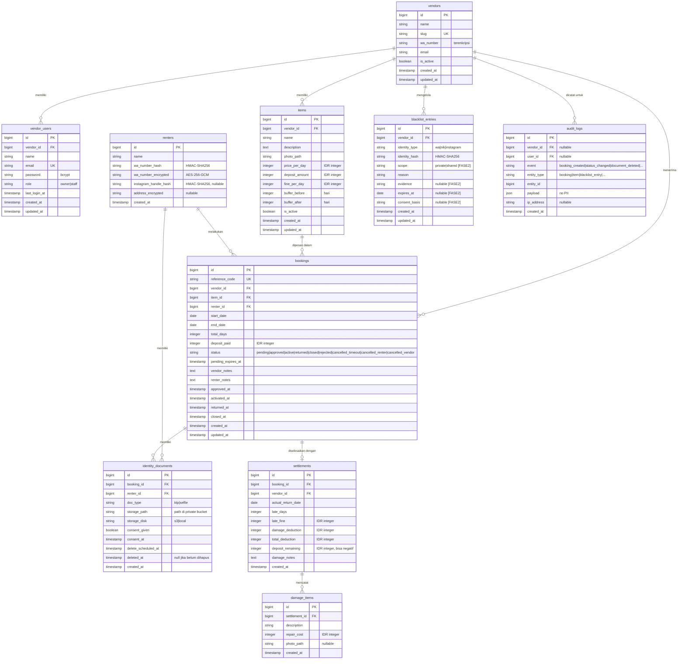

# ERD — JagaSewa MVP

---

## Diagram Entity-Relationship



---

## Kamus Data

### `vendors`
Toko/brand milik pemilik rental. Satu vendor = satu toko di MVP.

### `vendor_users`
Akun login yang berafiliasi dengan satu vendor. `role` enum: `owner`, `staff`.

### `items`
Barang yang disewakan. MVP: 1 item = 1 unit fisik. Kolom `price_per_day`, `deposit_amount`, `fine_per_day` dalam **integer rupiah**.

### `renters`
Data penyewa. **Tidak ada login.** Identitas disimpan dalam dua bentuk:
- `*_hash`: HMAC-SHA256 dari nilai ternormalisasi → untuk pencocokan blacklist (cepat, indexed)
- `*_encrypted`: AES-256-GCM → untuk ditampilkan vendor yang berhak (perlu dekripsi runtime)

### `bookings`
Inti sistem. Kolom kritis:
- `reference_code`: kode unik yang dikirim ke penyewa (format: `JS-YYYYMMDD-XXXX`)
- `status`: lihat BR-02 untuk transisi valid
- `pending_expires_at`: timestamp batas waktu pending (24 jam dari `created_at`)
- `vendor_id`: wajib ada untuk isolasi multi-vendor

### `identity_documents`
Menyimpan **path** ke file (bukan file itu sendiri). File ada di object storage privat.
- `delete_scheduled_at`: tanggal penghapusan dijadwalkan (BR-05)
- `deleted_at`: timestamp aktual penghapusan; jika `null` = file masih ada

### `blacklist_entries`
Hanya menyimpan **hash** identitas, bukan nilai asli. Kolom untuk Fase 2 (ditandai):
- `scope` (default: `'private'`) → Fase 2: `'shared'`
- `consent_basis` → Fase 2: dasar hukum pemrosesan data bersama
- `evidence` → Fase 2: bukti pendukung
- `expires_at` → Fase 2: masa berlaku entri

### `settlements`
Hasil perhitungan denda dan deposit. Satu-ke-satu dengan `bookings`.

### `damage_items`
Rincian kerusakan per item dalam satu settlement.

### `audit_logs`
Log immutable untuk keperluan debugging dan audit keamanan. **Tidak boleh menyimpan PII** (NIK, nomor WA, path file mentah).

---

## Indeks & Constraint Penting

```sql
-- Mencegah double booking: unique constraint + advisory lock saat insert
-- Query pengecekan bentrok menggunakan indeks komposit berikut:
CREATE INDEX idx_bookings_item_status_dates
    ON bookings (item_id, status, start_date, end_date);

-- Isolasi vendor:
CREATE INDEX idx_bookings_vendor_id ON bookings (vendor_id);
CREATE INDEX idx_items_vendor_id ON items (vendor_id);
CREATE INDEX idx_blacklist_vendor_id ON blacklist_entries (vendor_id);

-- Pencarian blacklist cepat via hash:
CREATE INDEX idx_blacklist_hash ON blacklist_entries (vendor_id, identity_hash);

-- Penghapusan dokumen terjadwal:
CREATE INDEX idx_identity_docs_delete_scheduled
    ON identity_documents (delete_scheduled_at)
    WHERE deleted_at IS NULL;

-- Reference code unik:
ALTER TABLE bookings ADD CONSTRAINT uq_bookings_reference_code UNIQUE (reference_code);
```

---

## Pencegahan Double Booking

Saat dua penyewa memesan item yang sama secara bersamaan:

1. **Transaksi DB + `SELECT ... FOR UPDATE`**: Query pengecekan ketersediaan dijalankan di dalam transaksi dengan lock baris pada `bookings` yang relevan.
2. **Urutan operasi**:
   ```
   BEGIN;
     SELECT id FROM bookings
       WHERE item_id = ?
         AND vendor_id = ?
         AND status IN ('pending','approved','active','returned')
         AND (start_date - buffer_before) <= (? + buffer_after_baru)
         AND (end_date + buffer_after) >= (? - buffer_before_baru)
       FOR UPDATE;
     -- Jika result kosong: INSERT booking baru
     -- Jika ada result: ROLLBACK + kembalikan error bentrok
   COMMIT;
   ```
3. **[ASUMSI]** MySQL InnoDB atau PostgreSQL digunakan; keduanya mendukung `SELECT FOR UPDATE`.

---

## Kolom yang Disiapkan untuk Fase 2

| Tabel | Kolom | Tujuan Fase 2 |
|-------|-------|--------------|
| `blacklist_entries` | `scope` | Membedakan blacklist pribadi vs. bersama |
| `blacklist_entries` | `consent_basis` | Dasar hukum UU PDP untuk berbagi data |
| `blacklist_entries` | `evidence` | Bukti pendukung (foto/dokumen) |
| `blacklist_entries` | `expires_at` | Masa berlaku entri (right to be forgotten) |
