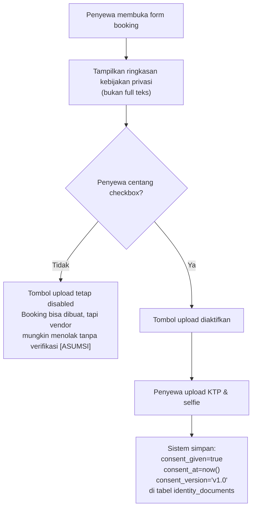
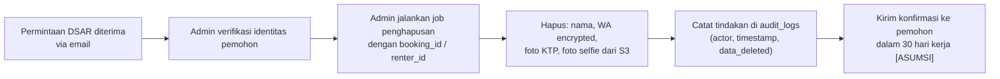
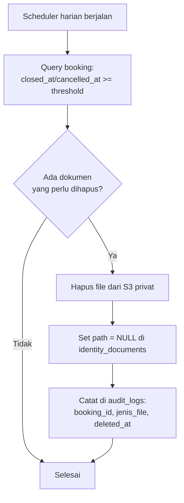

# `privacy-data-retention.md` — JagaSewa

> [!WARNING]
> DRAF. Bagian yang ditandai 🔍 **memerlukan tinjauan ahli hukum** sebelum peluncuran.

---

## 1. Inventaris Data

| Jenis Data | Sumber | Tujuan | Dasar Pemrosesan [ASUMSI 🔍] | Lokasi Simpan | Enkripsi | Masa Simpan |
|---|---|---|---|---|---|---|
| Nama penyewa | Form booking | Identifikasi booking | Kontrak / persetujuan 🔍 | DB (plaintext) | Tidak | 5 tahun setelah booking `closed` [ASUMSI] |
| Nomor WhatsApp penyewa | Form booking | Komunikasi, blacklist check | Kontrak / persetujuan 🔍 | DB (hash + encrypted) | HMAC + AES | Hash: permanen; Encrypted: hapus bersamaan nama setelah 5 tahun [ASUMSI] |
| NIK (hash saja) | Blacklist check | Verifikasi identitas | Kepentingan sah vendor 🔍 | DB (hash only) | HMAC | Sampai entri blacklist dihapus |
| Foto KTP | Upload saat booking | Verifikasi identitas | Persetujuan eksplisit 🔍 | S3 privat | SSE | Hapus 7 hari setelah booking `closed` atau 3 hari setelah `cancelled_*`/`rejected` (BR-05) |
| Foto selfie | Upload saat booking | Verifikasi identitas | Persetujuan eksplisit 🔍 | S3 privat | SSE | Hapus 7 hari setelah booking `closed` atau 3 hari setelah `cancelled_*`/`rejected` (BR-05) |
| Data booking (tanggal, barang, status) | Sistem | Operasional, audit | Kontrak 🔍 | DB | Tidak (non-PII) | 5 tahun [ASUMSI] |
| Data settlement / denda | Sistem | Bukti keuangan | Kewajiban hukum 🔍 | DB | Tidak | 5 tahun [ASUMSI] |
| Audit logs | Sistem | Keamanan, debugging | Kepentingan sah 🔍 | DB | Tidak | 1 tahun [ASUMSI] |
| Email vendor | Registrasi | Autentikasi, komunikasi | Kontrak 🔍 | DB | Tidak | Selama akun aktif + 1 tahun setelah tutup [ASUMSI] |
| Password vendor (hash) | Registrasi | Autentikasi | Kontrak 🔍 | DB (bcrypt) | bcrypt | Selama akun aktif |
| Blacklist entries (hash) | Vendor input | Peringatan vendor | Kepentingan sah vendor 🔍 | DB (hash only) | HMAC | Sampai vendor hapus atau akun `closed` |

---

## 2. Alur Persetujuan Penyewa

**Teks checkbox yang ditampilkan ke penyewa:**

> *"Saya setuju data KTP dan selfie saya digunakan untuk verifikasi booking ini dan akan dihapus otomatis dalam 7 hari setelah booking selesai (atau 3 hari jika dibatalkan)."*

> [!IMPORTANT]
> Tombol upload harus tetap **disabled** sampai checkbox dicentang. Ini adalah kontrol teknis yang memperkuat persetujuan eksplisit.

**Langkah-langkah alur:**

1. Penyewa membuka form booking.
2. Sebelum upload dokumen: tampilkan **ringkasan** kebijakan privasi (bukan full teks).
3. Checkbox eksplisit dengan teks di atas ditampilkan.
4. Tombol upload **disabled** sampai checkbox dicentang.
5. Sistem menyimpan: `consent_given=true`, `consent_at=now()`, `consent_version='v1.0'` di tabel `identity_documents`.
6. Jika penyewa tidak setuju: tidak bisa upload; booking tetap bisa dibuat tetapi vendor kemungkinan menolak tanpa verifikasi [ASUMSI].

---

## 3. Pembagian Peran: JagaSewa vs Vendor 🔍

| Peran | Kemungkinan Pengendali Data | Kemungkinan Prosesor Data | Catatan |
|---|---|---|---|
| JagaSewa sebagai platform | ✅ Atas data akun vendor, audit log | — | Perlu konfirmasi ahli hukum 🔍 |
| JagaSewa sebagai infrastruktur untuk vendor | — | ✅ Memproses data penyewa atas instruksi vendor | Perlu konfirmasi ahli hukum 🔍 |
| Vendor | ✅ Atas data penyewa (foto KTP, nama, WA) | — | Perlu konfirmasi ahli hukum 🔍 |

> [!CAUTION]
> Status hukum Pengendali vs Prosesor **harus** ditentukan oleh ahli hukum sebelum peluncuran. Kesalahan klasifikasi berdampak langsung pada kewajiban kepatuhan UU PDP 🔍.

---

## 4. Proses Permintaan Subjek Data (DSAR)

### 4.1 Subject Access Request & Right to Erasure

| Langkah | Keterangan |
|---|---|
| Saluran pengajuan | Email ke [ASUMSI: `privasi@jagasewa.id`] |
| Routing | JagaSewa meneruskan ke vendor terkait (sebagai pengendali data penyewa) 🔍 |
| Timeline respons | 30 hari kerja [ASUMSI — cek regulasi 🔍] |
| Data yang **bisa** dihapus | Nama, WA encrypted, foto KTP/selfie (jika masa retensi belum habis) |
| Data yang **tidak bisa** dihapus segera | Data billing/transaksi yang diperlukan oleh hukum [ASUMSI 🔍] |
| Mekanisme teknis | Admin menjalankan command/scheduled job dengan `booking_id`; tindakan dicatat di `audit_logs` |

### 4.2 Alur Teknis Penghapusan Manual

---

## 5. Jadwal Penghapusan Otomatis

| Data | Pemicu Penghapusan | Mekanisme | Dicatat Di |
|---|---|---|---|
| Foto KTP | 7 hari setelah booking `closed` (atau 3 hari setelah `cancelled_*`/`rejected`) | `AutoDeleteDocumentsJob` (scheduler) | `audit_logs` |
| Foto selfie | 7 hari setelah booking `closed` (atau 3 hari setelah `cancelled_*`/`rejected`) | `AutoDeleteDocumentsJob` (scheduler) | `audit_logs` |
| Foto KTP (fallback) | 90 hari setelah upload jika booking tidak pernah `closed` | `AutoDeleteDocumentsJob` | `audit_logs` |
| WA encrypted (penyewa lama) | 5 tahun setelah booking `closed` [ASUMSI] | Scheduled job | `audit_logs` |

> [!NOTE]
> `AutoDeleteDocumentsJob` harus berjalan setidaknya **sekali sehari**. Log eksekusi (sukses/gagal) wajib dipantau. Kegagalan penghapusan harus menghasilkan alert ke tim teknis.

---

## 6. Transfer Data Lintas Batas

- Semua data disimpan di server/bucket dalam wilayah **Indonesia atau Singapura** [ASUMSI: pilih provider yang memiliki region `ID` atau `SG`].
- Ikuti dokumentasi resmi provider cloud (AWS, GCP, dll.) untuk konfigurasi region spesifik.

> [!WARNING]
> 🔍 Perlu verifikasi oleh ahli hukum apakah transfer data ke Singapura memerlukan pengamanan atau mekanisme tambahan berdasarkan UU PDP dan regulasi turunannya.

---

## 7. Kontak & DPO

| Peran | Detail |
|---|---|
| Kontak privasi | [ASUMSI: `privasi@jagasewa.id`] |
| Data Protection Officer (DPO) | 🔍 Perlu ditentukan: apakah wajib per regulasi, dan siapa yang bertanggung jawab |

> [!NOTE]
> Kewajiban penunjukan DPO bergantung pada skala pemrosesan data dan klasifikasi data sensitif. Konsultasikan dengan ahli hukum sebelum peluncuran 🔍.

---

*Dokumen ini adalah draf internal. Tidak untuk dipublikasikan sebelum mendapat tinjauan hukum.*
